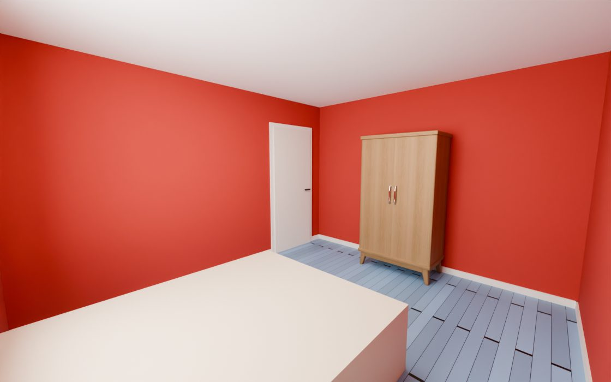
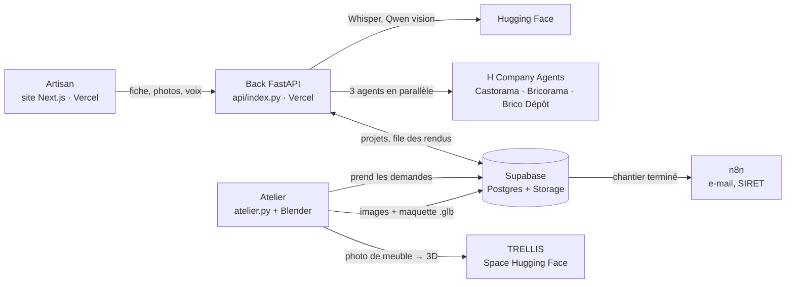
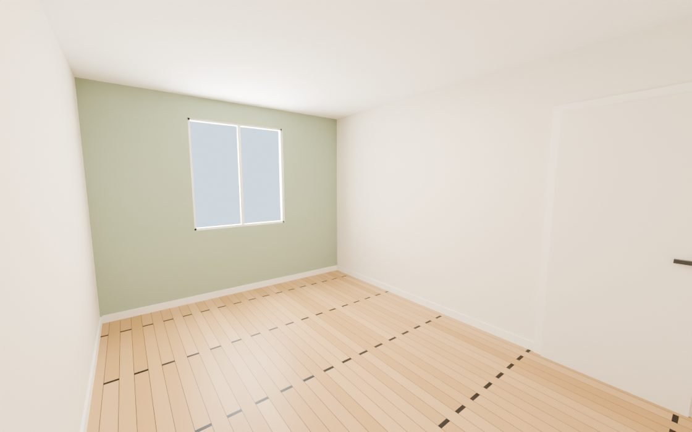
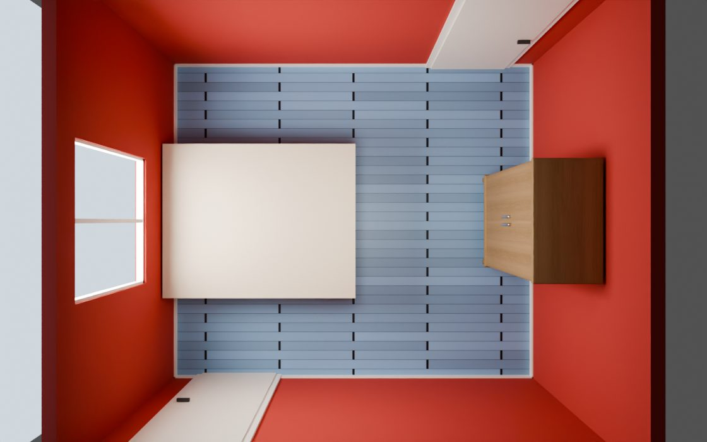

# Marcel Pro

**L'assistant de devis des artisans rénovateurs.** L'artisan décrit la pièce (à la voix, avec le plan et deux photos).
Des agents **H Company** relèvent en direct les prix chez trois fournisseurs. Marcel calcule les quantités, pré-remplit
le devis et le planning, et montre la pièce finie en 3D, avec les meubles du client.

Hackathon *Build The Future* (H Company × Vercel × Eugenia School), équipe 15. Novembre 2026.

| | |
|---|---|
| **Site** | https://marcel-front.vercel.app |
| **Back (API)** | https://marcel-back.vercel.app/api/sante |
| **Modèle économique** | [docs/modele-economique.md](docs/modele-economique.md) : 79 € HT par mois |



## Ce que fait Marcel, étape par étape

1. **Comprendre.** L'artisan dicte le chantier (Whisper → Qwen remplit la fiche) ou le saisit. Marcel lit les cotes sur la
   photo du plan et décrit l'état de la pièce sur les photos (Qwen, vision). Les dimensions saisies font foi : le modèle
   ne mesure rien, il propose, l'artisan confirme.
2. **Chiffrer.** Le code transforme la fiche en liste de produits et en quantités (surfaces, couches, rendements, chutes).
   Trois agents H Company (`h/web-surfer-flash`) partent en parallèle chez Castorama, Bricorama et Brico Dépôt : prix,
   contenance, stock en magasin, délai. Ils ne créent pas de compte, ne paient jamais et s'arrêtent sur un CAPTCHA.
   Le code compare et choisit le meilleur prix par produit.
3. **Montrer**, en parallèle du chiffrage. TRELLIS (Microsoft, Space Hugging Face) transforme la photo de chaque meuble
   en objet 3D, mis à l'échelle de ses vraies dimensions. Blender, piloté en Python, construit la pièce : dimensions,
   portes et fenêtres, couleurs (mur d'accent compris), parquet, meubles. Il produit des photos, une vue de dessus et une
   **maquette 3D** que l'on fait tourner dans le site.
4. **Rédiger.** Devis pré-rempli et modifiable (fournitures au meilleur prix + main-d'œuvre estimée, TVA 10 ou 20 %),
   export PDF avec les mentions obligatoires, planning en jours ouvrés avec la date limite de commande.
5. **Prévenir.** n8n envoie un e-mail à l'artisan quand le chantier est prêt. Il vérifie aussi le SIRET à l'inscription.

## Architecture



- **Le back est sans état** : tout vit dans Supabase (RLS activée ; seule la clé de service du back lit les chantiers).
- **L'atelier** tourne sur un poste où Blender est installé (aujourd'hui un Mac de l'équipe). Il va chercher le travail
  dans la file Supabase : aucune connexion entrante, et on peut en lancer plusieurs (une demande n'est prise qu'une fois).
- **Le code décide, les modèles lisent** : quantités, prix comparés, devis, planning et placement des meubles sont
  calculés par du code testé ; les modèles servent à lire (voix, photos, plan, sites des fournisseurs) et à modéliser.

## Mesures (19 novembre 2026, chantiers réels lancés depuis le site)

| Étape | Mesure |
|---|---|
| Chiffrage, 3 fournisseurs en parallèle | 5 min 40 à 7 min 40, environ 55 étapes par agent, **≈ 0,55 crédit H** par chantier |
| Meilleur prix vs un seul fournisseur | Chambre de Jade : 164,88 € contre 199,19 € (**−17 %**) |
| Dictée (20 s de voix) | Whisper 3,8 s, fiche remplie en 1,3 s de plus |
| Lecture du plan coté | 1,6 s, dimensions exactes sur notre plan de test |
| Meuble 3D (TRELLIS) | 26 à 36 s par nouveau meuble ; **1 s** quand il est déjà en cache (même photo, même recompressée) |
| Rendu Blender (photos + vue de dessus + maquette) | 60 à 90 s, prêt avant la fin du chiffrage |

Détails, échecs et retours sur l'Agent API : [RETOURS.md](RETOURS.md).

<table><tr>
<td></td>
<td></td>
</tr></table>

## Tester

**Sur le site** : https://marcel-front.vercel.app → « Essayer avec mon SIRET » (SIRET de test : `79084341100022`),
puis « Nouveau chantier ». Un chantier complet prend une dizaine de minutes ; le visuel 3D arrive en premier.

**Les tests du code** (aucun réseau, aucune clé) :

```bash
uv run --with pytest pytest -q tests
```

22 tests : surfaces et ouvertures (y compris à créer), quantités, mur d'accent en deux pots, lecture des couleurs,
placement des meubles, emplacements lus sur le plan, calcul des prix au format français, unités, planning sans week-end,
contrôles de la dictée et du plan, cache visuel des meubles.

## Lancer en local

```bash
brew install uv && uv sync                       # Python 3.12
uv run uvicorn api.index:app --port 8787         # le back ; puis : curl localhost:8787/api/sante
uv run --group outils atelier.py                 # l'atelier (TRELLIS + Blender), à lancer sur un poste avec Blender
./atelier_jury.sh                                # le même, qui se relance seul et empêche la mise en veille
```

Clés **uniquement en variables d'environnement** (jamais dans le dépôt) : `HAI_API_KEY` (H Company), `HF_TOKEN`
(Hugging Face), `SUPABASE_URL` et `SUPABASE_SERVICE_KEY` (back et atelier seulement).

## Organisation du dépôt

| Chemin | Rôle |
|---|---|
| `api/index.py` | API du site (FastAPI sur Vercel) : chantiers, questions, agents, résultat, devis PDF, dictée, plan, rendus |
| `marcel_core/` | le cœur : `chantier.py` (fiche → produits, quantités, devis, planning), `chiffrage.py` (consignes des agents, comparaison des prix), `agents.py` (H Company), `rendus.py` (fiche → scène 3D, couleurs, meubles, file Supabase), `objets3d.py` (TRELLIS), `dictee.py`, `plan.py`, `hf.py` (Hugging Face), `devis_pdf.py` |
| `rendu/marcel_rendu.py` | le script Blender : pièce rectangulaire ou en L, ouvertures, couleurs, parquet (lames ou chevron), papier peint, meubles, caméras, maquette `.glb` |
| `atelier.py`, `atelier_jury.sh` | l'atelier qui traite la file des rendus |
| `supabase/` | schéma SQL, RLS, file des rendus |
| `n8n workflows/` | les deux workflows n8n (e-mail de résultat, vérification du SIRET) |
| `tests/` | tests du cœur |
| `docs/` | contrat front/back ([API_FRONT.md](docs/API_FRONT.md)), pipeline 3D ([MEUBLES_3D.md](docs/MEUBLES_3D.md)), pièces en L ([RENDU_PIECES_EN_L.md](docs/RENDU_PIECES_EN_L.md)), architecture, modèle économique ; `docs/prompts_v0/` : les prompts qui ont construit le site avec v0 |
| `assets/logo/` | le logo (raton laveur) et ses trois animations, en SVG |
| `marcel.py`, `test_enseignes.py`, `test3d.py`, `bench3d.py`, `insertion.py`, `hf_test.py`, `test3d/` | **prototypes du 17 novembre** : accès des enseignes, premier parcours complet, comparatif des modèles image → 3D. Gardés comme trace des essais (résultats dans RETOURS.md) |

## Limites connues et suite

- **Comptes** : l'inscription est gardée dans le navigateur, et la liste des chantiers est filtrée par e-mail. Prochaine
  étape : Supabase Auth (jeton vérifié par le back).
- **Pièces non rectangulaires** : le rendu sait faire les pièces en L (contour) ; la saisie du contour dans le site et
  les surfaces correspondantes restent à brancher.
- **Coût des agents** (≈ 85 % du coût d'un chantier) : garder les prix relevés 24 h par magasin pour éviter les recherches
  en double ; ajouter les fournisseurs professionnels qui affichent leurs prix sans compte.
- **Atelier** : aujourd'hui sur un poste de l'équipe ; demain sur des serveurs (même code, aucune modification du site).
- **Quota GPU** de TRELLIS : limité en compte gratuit ; les meubles déjà modélisés sont servis depuis le cache.
