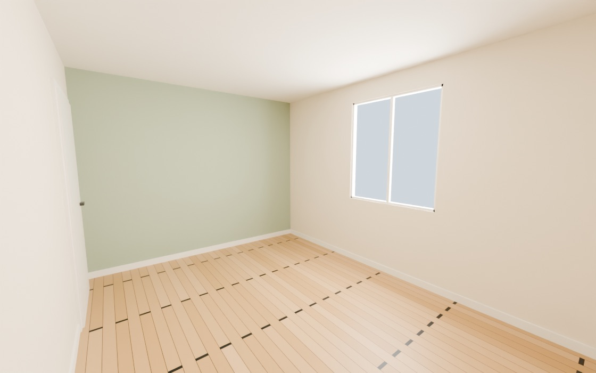

# Pour King — jeudi 19/11

Trois branches à récupérer, dans cet ordre. Chacune contient la précédente : fusionner `feat/couleurs` suffit pour tout avoir.

| Branche | Ce qu'elle apporte | Testé |
|---|---|---|
| `feat/lecture-plan` | `POST /api/plan` : lit les cotes sur la photo du plan | 1 plan net, tout juste en 2 s |
| `feat/dictee` | `POST /api/dictee` : l'artisan dicte, la fiche se remplit | 2 enregistrements (voix de synthèse, format m4a) |
| `feat/couleurs` | couleurs des murs dans le rendu + essai « produit similaire » | voir ci-dessous |

Mode d'emploi des routes pour le site : `docs/API_FRONT.md`.

## 1. Ta question : « est-ce que Blender peint les murs ? »

Oui, mais tu avais raison, ça marchait mal. Trois causes, corrigées dans `feat/couleurs` :

1. **Seuls 20 noms exacts étaient reconnus.** « Vert sauge mat » ou « Bleu canard satiné » ne correspondaient à rien : murs rendus en blanc, avec juste une alerte.
   Maintenant : 55 noms, reconnus même au milieu d'une phrase, sans tenir compte des accents ni de « mat / satin / velours ».
   Un nom rare (« terre de Sienne », « RAL 7016 ») est converti par Qwen en couleur approchée, avec une alerte « à confirmer avec le nuancier ».
2. **La teinte par défaut « Blanc cassé » était presque identique au blanc.** Elle est un peu plus chaude maintenant, on voit la différence avec le plafond.
3. **Une seule couleur pour les quatre murs.** On peut maintenant faire un mur d'accent et teinter le plafond.

Nouveaux champs de la demande de rendu (`POST /api/rendu`), tous facultatifs :

```json
{"peinture": "Blanc cassé mat",
 "peinture_par_mur": {"gauche": "vert sauge"},
 "plafond": "blanc"}
```

Murs : `fond`, `avant`, `gauche`, `droit`. Un code `#RRGGBB` est accepté partout.

Résultat du test (blanc cassé + mur gauche vert sauge, 46 s en qualité rapide) :



Limites connues :
- le parcours artisan n'envoie que `teinte_murs` (une couleur). Pour un mur d'accent, il faut une question en plus dans `chantier.py`, ou que le site envoie `peinture_par_mur` ;
- la lumière éclaircit les teintes : un vert sauge sort plus pâle que sur un nuancier ;
- le sol montre de petits traits sombres entre certaines lames (défaut d'affichage, déjà présent avant).

Pour refaire le test sur le poste de l'atelier :

```bash
uv run --group outils atelier.py --fichier cas/rendu_couleurs.json
```

## 2. À tester : le « produit similaire » (idée de Gaspard, façon Google Lens)

But : à partir d'une photo d'inspiration du client, proposer à l'artisan des papiers peints ou revêtements proches, avec prix.
C'est un ESSAI : rien n'est branché au site. Le fichier est `similaire.py`.

### Étape A — sans rien installer (30 secondes)

```bash
uv run --group outils similaire.py --mots inspiration.jpg
```

Qwen décrit le revêtement et donne les mots à taper chez le fournisseur.
Testé sur une photo de parquet : `"recherche": "parquet point de Hongrie bois"`, en 1,2 s.
Ces mots peuvent partir tels quels dans la consigne de l'agent H.

### Étape B — comparaison d'images sur ton poste

Il faut un petit catalogue : un dossier avec des photos de produits (50 à 100 suffisent pour juger),
et si possible `catalogue.csv` à côté (colonnes `fichier,nom,prix,lien`).

```bash
uv run --with torch --with transformers --with pillow --with numpy similaire.py catalogue/ inspiration.jpg
```

- Première fois : téléchargement du modèle (SigLIP 2, Apache, environ 400 Mo). Si le téléchargement échoue, relancer avec `HF_HUB_DISABLE_XET=1` devant la commande.
- Le modèle tourne sur ton poste : il n'existe pas en appel direct sur Hugging Face, c'est pour ça qu'il n'est pas dans l'API Vercel.
- Les empreintes du catalogue sont gardées dans `catalogue/.index.npz` ; elles sont recalculées si le dossier change.

Testé ici sur 3 images seulement, pour vérifier que ça tourne : un morceau recadré d'une photo de parquet retrouve bien la photo d'origine (0,89, contre 0,61 et 0,50 pour les deux autres). **Ça ne prouve rien sur de vrais papiers peints.**

### Ce qu'on aimerait savoir

1. Avec 50 vrais papiers peints d'un fournisseur et 3 photos d'inspiration : les 3 premiers résultats sont-ils crédibles pour un artisan ?
2. L'agent H peut-il rapporter les photos des produits (pour constituer le catalogue), ou seulement les prix ?
3. Combien de temps pour 100 images sur ton poste ?

Si la réponse à 1 est non, on garde seulement l'étape A pour vendredi et le reste va dans la feuille de route du pitch.

Autres modèles regardés, au cas où : `google/embeddinggemma-2` (plus récent, Apache), `Marqo/marqo-ecommerce-embeddings-B` (entraîné sur des photos de produits, Apache), `facebook/dinov3` (le meilleur sur les textures, mais accès à demander). Aucun n'a d'appel direct non plus.
