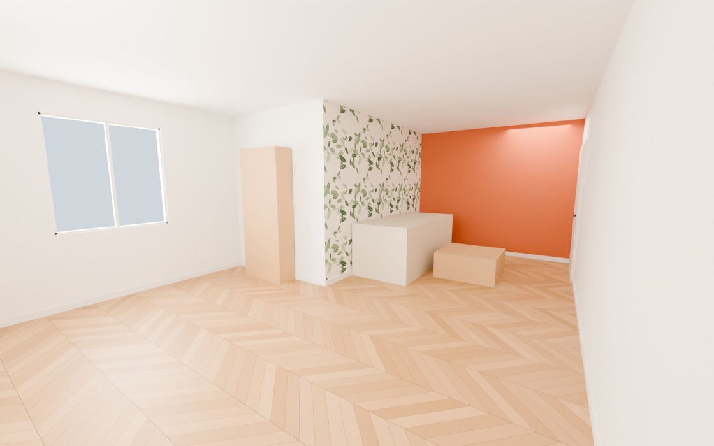
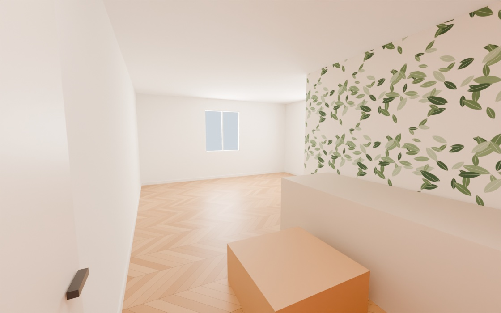
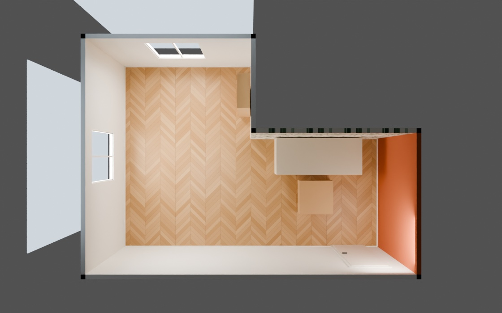

# Rendu Blender : pièces en L, parquet en chevron, papier peint

Trois ajouts au script `rendu/marcel_rendu.py`. Les pièces rectangulaires passent par le même chemin qu'avant :
sur le même fichier de chantier, les images sont identiques au pixel près avant et après (vérifié le 19 novembre).

## Essayer

```bash
/Applications/Blender.app/Contents/MacOS/Blender --background --python rendu/marcel_rendu.py -- rendu/chantier_salon_en_L.json out/salon_en_L
```

Environ 45 secondes en qualité rapide. Résultat : `photo1.png`, `photo2.png`, `dessus.png`, `maquette.glb`.





## Ce qu'on écrit dans le fichier de chantier

| Clé | Rôle |
|---|---|
| `contour` | les angles de la pièce `[x, y]` en mètres, dans l'ordre, murs à angle droit. Remplace `largeur` et `profondeur`. |
| `murs_noms` | le nom de chaque mur : le mur n°1 va de l'angle 1 à l'angle 2, etc. Sans cette clé : `mur1`, `mur2`… |
| `sol_pose: "chevron"` | parquet en chevron, dans les deux teintes de `sol`. Réglages : `chevron_travee_m` (0,42), `chevron_lame_m` (0,09). |
| `papier_peint` | `{"nom du mur": {"image": "motifs/feuillage.jpg", "largeur_m": 0.8}}` : l'image est répétée, `largeur_m` est la largeur réelle d'un motif. |

Les ouvertures, les meubles contre un mur et `peinture_murs` s'écrivent comme avant, avec les noms de `murs_noms`.
La position d'une ouverture reste la distance au coin gauche du mur, vu de l'intérieur.
Avec un contour, la clé `pos` d'un meuble libre se lit dans le repère du plan (celui de `contour`).
Le chevron et le papier peint marchent aussi dans une pièce rectangulaire.

## Ce qui n'est pas fait

- **Le site et l'API ne savent pas le demander.** `DemandeRendu` (`marcel_core/rendus.py`) ne transporte ni `contour`, ni `sol_pose`,
  ni `papier_peint`. Aujourd'hui, ce rendu se lance à la main avec un fichier de chantier.
- **Le chiffrage reste sur un rectangle** (longueur × largeur).
- **Murs à angle droit seulement** : pas de pan coupé ni de mur courbe.
- **Meubles en volumes simples dans l'exemple** : les modèles 3D (TRELLIS) n'ont pas été essayés dans une pièce en L.
- **La seconde photo** est parfois trop près d'un meuble bas : le choix du point de vue reste simple.
- **Le motif `feuillage.jpg`** est un motif dessiné pour l'essai, pas un vrai papier peint du commerce.
- La maquette `.glb` est produite, mais je ne l'ai pas ouverte dans le site.
